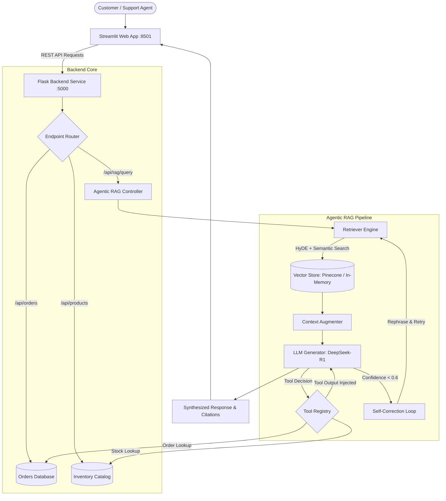

# 🛒 E-Commerce Support Agentic RAG

[](https://www.python.org/)
[](https://flask.palletsprojects.com/)
[](https://streamlit.io/)
[](https://www.langchain.com/)
[](https://deepseek.com/)
[](https://platform.openai.com/)
[](LICENSE)

An intelligent, production-ready **Agentic Customer Support Assistant** for e-commerce storefronts. By combining **DeepSeek-R1 reasoning**, **OpenAI semantic embeddings**, and **autonomous tool calling**, this system eliminates hallucinations for live transactional data while accurately answering unstructured store policy questions.

---

## 🌟 Key Highlights

- **Autonomous Tool Calling**: Automatically invokes background API tools (`get_order_status`, `check_product_stock`) for live dynamic lookups, completely eliminating hallucinations on order numbers and inventory counts.
- **Self-Correcting RAG Loop**: Evaluates retrieval confidence scores on the fly; if confidence drops below threshold (`0.6`), it refines the prompt using partial context and re-retrieves before generating an answer.
- **Advanced Retrieval (HyDE + MMR)**: Employs **Hypothetical Document Embeddings (HyDE)** to search by semantic intent and **Maximal Margin Relevance (MMR)** to avoid redundant results.
- **Hybrid Cost-Optimal LLM Stack**: Uses OpenAI's `text-embedding-3-large` for top-tier retrieval relevance and DeepSeek-R1 for cost-effective reasoning.
- **Dual Vector Store Strategy**: Supports **Pinecone** for cloud-scale indexing and a zero-dependency **In-Memory Store** with deterministic fallback embeddings for 100% offline local development.
- **Interactive Multi-View Dashboard**: Modern Streamlit UI with dark-mode compatibility, conversational AI assistant, live order tracking with interactive GPS maps, and real-time inventory gauges.

---

## 🏗️ Architecture Flow



---

## 📁 Project Structure

```
├── api/
│   ├── app/
│   │   ├── __init__.py            # Flask app factory, CORS & health endpoints
│   │   ├── routes.py              # Core API routes & lazy RAG controller initialization
│   │   └── services/              # Business services (order, product, return, shipping)
│   ├── integrations/              # FakeStore API integration client
│   └── utils/
│       ├── mock_data.py           # In-memory mock database (orders, catalog, policies)
│       └── redis_manager.py       # Session cache with graceful in-memory fallback
├── data/
│   └── documents/                 # Sample policy documents (returns, shipping, warranties)
├── frontend/
│   └── streamlit_app.py           # Streamlit UI with dark-theme styling & interactive tools
├── rag/
│   ├── agents/
│   │   ├── agentic_controller.py  # Multi-hop reasoning & self-correction loop
│   │   └── tools/tool_registry.py # Tool declarations and function execution schemas
│   ├── augmentation/augmenter.py  # Prompt construction & confidence scoring
│   ├── evaluation/                # Golden benchmark dataset & RAGAS evaluation scripts
│   ├── generation/generator.py    # DeepSeek API integration with local fallback
│   ├── ingestion/                 # Document loaders (PDF/CSV/JSON) & semantic chunker
│   └── retrieval/                 # Vector stores & HyDE/MMR retriever engine
├── tests/                         # Unit tests, API integration tests & agent verification
├── .env.example                   # Environment configuration template
├── config.py                      # Application configuration classes
└── requirements.txt               # Pinned Python dependencies
```

---

## 🚀 Quickstart: Local Setup (Windows PowerShell)

### 1. Clone & Navigate to Repository
```powershell
git clone https://github.com/<your-username>/agentic-ecommerce-rag.git
cd agentic-ecommerce-rag
```

### 2. Create & Activate Virtual Environment
```powershell
python -m venv venv
.\venv\Scripts\Activate.ps1
```

### 3. Install Dependencies
```powershell
python -m pip install --upgrade pip
pip install -r requirements.txt
```

### 4. Configure Environment Variables
Copy the template configuration file:
```powershell
Copy-Item .env.example .env
```
*(By default, `VECTOR_STORE_TYPE=in_memory` and local fallback mode are active, allowing immediate execution without requiring external API keys).*

### 5. Index Knowledge Base Documents
```powershell
python -m rag.retrieval.index_sample_docs
```

### 6. Run Automated Test Suite
```powershell
python -m unittest discover tests
```
*(Runs 23 automated tests verifying health endpoints, order lookups, stock checks, and agentic tools).*

### 7. Launch the Application

**Terminal 1 (Flask REST Backend):**
```powershell
.\venv\Scripts\Activate.ps1
python api/app/__init__.py
```
*Backend runs on `http://localhost:5000` (Health Check: `http://localhost:5000/api/health`)*

**Terminal 2 (Streamlit Frontend):**
```powershell
.\venv\Scripts\Activate.ps1
streamlit run frontend/streamlit_app.py
```
*Frontend runs on `http://localhost:8501`*

---

## 💬 Sample Queries to Test

| Query | What Happens |
|---|---|
| `"Where is my order ORD-1001?"` | Triggers `get_order_status` tool -> Returns: *Shipped, arriving 2025-11-08* |
| `"Is Laptop Pro in stock?"` | Triggers `check_product_stock` tool -> Returns: *8 units available* |
| `"How many Galaxy S21 do you have?"` | Triggers `check_product_stock` tool -> Returns: *Out of stock, restock on 2025-11-20* |
| `"What is the return policy?"` | Semantic retrieval from `returns_policy.pdf` -> Cites 30-day unopened window |
| `"How long does shipping take?"` | Semantic retrieval from `shipping_policy.pdf` -> Explains standard vs. expedited |
| `"What is the warranty on the Laptop Pro?"` | Semantic retrieval from `laptop_warranty.pdf` -> Cites 2-year warranty |

---

## 📡 REST API Reference

| Endpoint | Method | Description |
|---|---|---|
| `/health` & `/api/health` | `GET` | Health status and active vector database engine |
| `/api/rag/query` | `POST` | Agentic RAG query endpoint with multi-hop tool execution |
| `/api/orders/<order_id>` | `GET` | Order tracking information by ID |
| `/api/products/<product_name>/stock` | `GET` | Real-time product inventory lookup |
| `/api/returns/validate` | `POST` | Validates return eligibility for an order |
| `/api/returns` | `POST` | Issues a new return ticket |
| `/api/returns/policy` | `GET` | General or product-specific return guidelines |
| `/api/shipping` | `GET` | Shipping rates, thresholds, and supported carriers |
| `/api/payment/methods` | `GET` | Accepted payment methods and security standards |

---

## 📊 Evaluation & Benchmarking

The project includes an evaluation suite under `rag/evaluation/`:
- **Golden Dataset**: `ecommerce.jsonl` contains 20 curated query-answer benchmark pairs with target tool calls and document citations.
- **RAGAS Metrics**: Automated evaluation script (`evaluate_rag.py`) tracks faithfulness, answer relevancy, context recall, and tool call precision.

---

## 📄 License

This project is licensed under the MIT License - see the [LICENSE](LICENSE) file for details.
