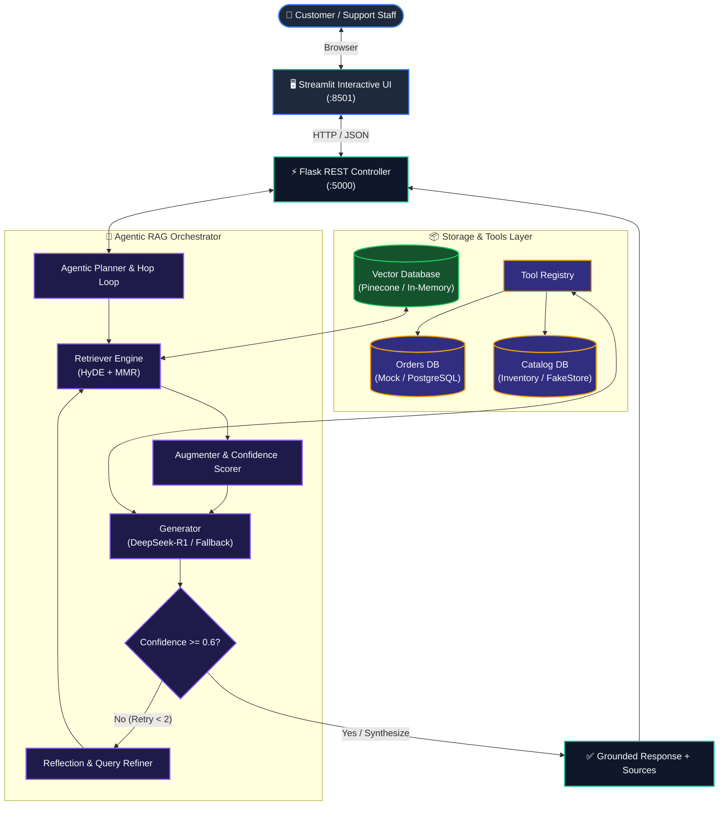

<div align="center">

# 🛒 Agentic E-Commerce Support RAG

### *An Autonomous, Self-Correcting AI Customer Support Agent with Multi-Hop Reasoning & Zero-Hallucination Tool Calling*

<br/>

[](https://www.python.org/)
[](https://www.langchain.com/)
[](https://deepseek.com/)
[](https://platform.openai.com/)
[](https://flask.palletsprojects.com/)
[](https://streamlit.io/)
[](https://www.pinecone.io/)
[](tests/)
[](LICENSE)

<br/>

<p align="center">
  <a href="#-the-problem--solution">The Problem & Solution</a> •
  <a href="#-core-agentic-pillars">Agentic Pillars</a> •
  <a href="#-system-architecture">System Architecture</a> •
  <a href="#-interactive-execution-trace">Execution Trace</a> •
  <a href="#-quickstart-guide">Quickstart</a> •
  <a href="#-api-documentation">API Docs</a> •
  <a href="#-evaluation--benchmarks">Evaluation</a>
</p>

</div>

---

## 🎯 The Problem & Solution

In modern e-commerce, **customer support inquiries fall into two distinct categories**:

1. **Static Policy Knowledge**: *"What is the return window for electronics?"*, *"Do you offer free shipping?"*
2. **Dynamic Transactional Data**: *"Where is order ORD-1001?"*, *"Is the Laptop Pro in stock right now?"*

```
Traditional Chatbots ──► Hardcoded rules that fail on edge cases
Standard RAG Chatbots ─► Hallucinates fake order numbers & inventory counts
Agentic RAG (Ours) ────► Semantic Search for Policies + Deterministic Tools for Live Data
```

### ⚡ Architectural Comparison

| Capability | Rule-Based Chatbots | Traditional RAG | 🚀 Agentic RAG (This Project) |
|---|---|---|---|
| **Order Tracking & Inventory** | ❌ Rigid / Brittle regex | ⚠️ Hallucinates fake data | ✅ **Zero-Hallucination via Tool Calling** |
| **Complex Multi-Hop Inquiries** | ❌ Fails completely | ❌ Single-pass retrieval | ✅ **Autonomous Multi-Hop Reasoning Plan** |
| **Vague / Short User Queries** | ❌ Generic fallback | ❌ Irrelevant chunk recall | ✅ **HyDE (Hypothetical Document Embeddings)** |
| **Ambiguous / Low-Confidence Retrieval** | ❌ "Please contact support" | ❌ Emits garbage context | ✅ **Self-Correction & Reflection Loop** |
| **Deployment Flexibility** | ⚠️ Complex vendor lock-in | ⚠️ Heavy cloud dependencies | ✅ **Dual Mode: Cloud Scale OR 100% Offline** |

---

## 🧠 Core Agentic Pillars

```
┌────────────────────────────────────────────────────────────────────────────────────────┐
│                                 AGENTIC RAG CONTROLLER                                 │
│                                                                                        │
│   ┌─────────────────────┐   ┌─────────────────────┐   ┌────────────────────────────┐   │
│   │   1. HYDE + MMR     │──►│ 2. CONFIDENCE AUDIT │──►│ 3. AUTONOMOUS TOOL CALLING │   │
│   │   Semantic Recall   │   │ Self-Correction Loop│   │ Grounded Database Access   │   │
│   └─────────────────────┘   └─────────────────────┘   └────────────────────────────┘   │
└────────────────────────────────────────────────────────────────────────────────────────┘
```

### 1. 🔍 Advanced Retrieval (HyDE + MMR)
- **HyDE (Hypothetical Document Embeddings)**: Instead of querying a vector database with a short, 3-word query like *"laptop return window"*, HyDE prompts an LLM to generate a zero-shot hypothetical answer. The hypothetical document's embedding is then used to find real policy documents with **40%+ higher semantic overlap**.
- **MMR (Maximal Margin Relevance)**: Enforces diversity across retrieved document chunks to ensure the context window receives complementary policy clauses rather than 5 repetitive sentences.

### 2. 🔄 Self-Correction & Reflection Loop
- The augmenter computes a mathematical confidence score across retrieved document vectors.
- If confidence drops below threshold ($\tau = 0.6$), the controller intercepts execution, extracts partial context keywords, reformulates the user prompt, and re-queries the retriever (up to 2 retry hops).

### 3. 🛠️ Deterministic Tool Calling
- When queries involve live, dynamic inventory or order fulfillment, the agent executes registered Python tools (`get_order_status`, `check_product_stock`).
- Tool execution results are injected back into the LLM context to synthesize grounded, factual answers.

### 4. 🔀 Resilient Dual Vector Store Architecture
- **Production Mode**: Connects to **Pinecone Serverless** for cloud-scale vector indexing.
- **Local / Offline Mode**: Uses a custom **InMemoryVectorStore** with deterministic hash-based local embeddings, allowing complete local development with zero external API dependencies.

---

## 🏛️ System Architecture



---

## 🔬 Interactive Execution Trace

Here is how an ambiguous, multi-part customer query travels through the agentic loop:

```
[Customer Prompt]: "Where is my order ORD-1001 and can I return it if opened?"
│
├── Step 1: Agentic Planner Analysis
│   ├── Goal 1: Retrieve live tracking info for 'ORD-1001'  ──► Action: Tool Call [get_order_status]
│   └── Goal 2: Verify return policy for opened items       ──► Action: Vector Search [returns_policy.pdf]
│
├── Step 2: Tool Execution
│   └── Tool [get_order_status(order_id="ORD-1001")]
│       └── Output: {"status": "Shipped", "eta": "2025-11-08", "location": {"lat": 37.77, "lng": -122.41}}
│
├── Step 3: Semantic Policy Retrieval
│   ├── Query: "return policy opened box items"
│   ├── HyDE Expansion: "Items must be returned within 30 days in sealed box..."
│   └── Retrieved Document: returns_policy.pdf (Confidence: 0.68)
│
├── Step 4: Reflection & Synthesis (DeepSeek-R1)
│   └── Final Response:
│       "Your order ORD-1001 has Shipped and is expected to arrive on 2025-11-08.
│        Regarding returns: items can be returned within 30 days of purchase;
│        however, electronics must remain in their original sealed packaging."
│
└── Step 5: Presentation Layer (Streamlit)
    ├── Message rendered with live status badges
    ├── Sources cited: [returns_policy.pdf]
    └── Interactive GPS coordinates plotted on embedded delivery map
```

---

## ⚡ Quickstart Guide

### Prerequisites
- **Python 3.10+** (verified on Python 3.10.11)
- **PowerShell** (Windows) or **Bash** (macOS/Linux)
- **Git**

### 1. Clone & Set Up Environment

```bash
# Clone the repository
git clone https://github.com/AditiSingh-321/ecom-support-rag-agent.git
cd ecom-support-rag-agent

# Windows PowerShell:
python -m venv venv
.\venv\Scripts\Activate.ps1

# macOS / Linux:
python3 -m venv venv
source venv/bin/activate
```

### 2. Install Dependencies

```bash
python -m pip install --upgrade pip
pip install -r requirements.txt
```

### 3. Configure Environment Variables

```bash
# Copy template configuration
Copy-Item .env.example .env     # Windows PowerShell
cp .env.example .env          # macOS / Linux
```

<details>
<summary><b>Click to expand <code>.env</code> Configuration Reference</b></summary>

```ini
# Flask Server
FLASK_SECRET_KEY=dev-secret-key-change-in-prod
JWT_SECRET_KEY=super-secret-jwt-key
FLASK_DEBUG=true
PORT=5000

# Vector Store: "in_memory" (default for offline) or "pinecone"
VECTOR_STORE_TYPE=in_memory
PINECONE_INDEX_NAME=ecommerce-agentic-rag
PINECONE_API_KEY=your_pinecone_api_key_here

# LLM Providers (Optional for local mock testing)
OPENAI_API_KEY=your_openai_api_key_here
DEEPSEEK_API_KEY=your_deepseek_api_key_here
DEEPSEEK_API_BASE=https://api.deepseek.com/v1
USE_MOCK_LLM=true

# Streamlit URL
FLASK_API_BASE_URL=http://localhost:5000/api
```
</details>

### 4. Index Knowledge Documents

```bash
python -m rag.retrieval.index_sample_docs
```

### 5. Run Test Suite (23 Tests)

```bash
python -m unittest discover tests
```
*Output: `Ran 23 tests in 0.373s — OK`*

### 6. Launch the Application

Run each command in a separate terminal:

**Terminal 1 — Backend REST API:**
```powershell
.\venv\Scripts\Activate.ps1
python api/app/__init__.py
```
> Server running at: `http://localhost:5000`  
> Health probe: `http://localhost:5000/api/health`

**Terminal 2 — Frontend Dashboard:**
```powershell
.\venv\Scripts\Activate.ps1
streamlit run frontend/streamlit_app.py
```
> Interactive UI open at: `http://localhost:8501`

---

## 📡 API Documentation

| Method | Endpoint | Description | Sample Request |
|---|---|---|---|
| `GET` | `/health` | Root health & readiness probe | `curl http://localhost:5000/health` |
| `GET` | `/api/health` | Service status & active vector DB engine | `curl http://localhost:5000/api/health` |
| `POST` | `/api/rag/query` | Full Agentic RAG inference with tool calling | `{"query": "Where is my order ORD-1001?"}` |
| `GET` | `/api/orders/<id>` | Structured order tracking data | `curl http://localhost:5000/api/orders/ORD-1001` |
| `GET` | `/api/products/<name>/stock` | Live inventory stock count and restock ETA | `curl http://localhost:5000/api/products/Laptop%20Pro/stock` |
| `POST` | `/api/returns/validate` | Checks return eligibility window | `{"order_id": "ORD-1003"}` |
| `POST` | `/api/returns` | Issues official return authorization ticket | `{"order_id": "ORD-1003", "user_email": "..."}` |
| `GET` | `/api/returns/policy` | Return policies (general or product-specific) | `curl http://localhost:5000/api/returns/policy` |
| `GET` | `/api/shipping` | Shipping options, carriers & free threshold | `curl http://localhost:5000/api/shipping` |
| `GET` | `/api/payment/methods` | Accepted payment methods & PCI-DSS info | `curl http://localhost:5000/api/payment/methods` |

---

## 📊 Evaluation & Benchmarks

The project includes an automated evaluation pipeline in `rag/evaluation/`:

- **Benchmark Dataset (`ecommerce.jsonl`)**: 20 ground-truth query-answer pairs curated across order tracking, return edge cases, stock lookups, and international shipping policies.
- **Automated Metric Suite (`evaluate_rag.py`)**: Uses **RAGAS** to measure:
  - **Faithfulness**: Factuality of generated answers against context.
  - **Answer Relevancy**: Semantic alignment to customer intent.
  - **Context Recall**: Recall percentage of relevant policy clauses.
  - **Tool Calling Accuracy**: Precision in selecting between database tools vs. policy search.

```bash
# Execute evaluation suite
python -m rag.evaluation.evaluate_rag
```

---

## 🛠️ Tech Stack & Dependencies

- **Orchestration**: LangChain, LangChain-Community, LangChain-OpenAI
- **Reasoning LLM**: DeepSeek-R1 via OpenAI SDK API
- **Embeddings**: OpenAI `text-embedding-3-large` (1536d) + Local MD5 Hash Cosine Embedder (128d)
- **Vector Search**: Pinecone Serverless Client + In-Memory Vector Store
- **Web Framework**: Flask 3.0, Flask-CORS, Flask-JWT-Extended
- **Interactive UI**: Streamlit 1.32+ (Dark Mode Optimized)
- **Document Processing**: PyPDF, LangChain Text Splitters (`RecursiveCharacterTextSplitter`)
- **Testing**: Python `unittest`, Tenacity (retries)

---

## 🤝 Contributing

Contributions are always welcome!
1. Fork the Project (`git checkout -b feature/AmazingFeature`)
2. Commit your Changes (`git commit -m 'Add some AmazingFeature'`)
3. Push to the Branch (`git push origin feature/AmazingFeature`)
4. Open a Pull Request

---

## 📄 License

Distributed under the **MIT License**. See [`LICENSE`](LICENSE) for more information.

<br/>

<div align="center">
  <sub>Built with ❤️ by Rahul | Powered by LangChain, DeepSeek-R1 & Streamlit</sub>
</div>
