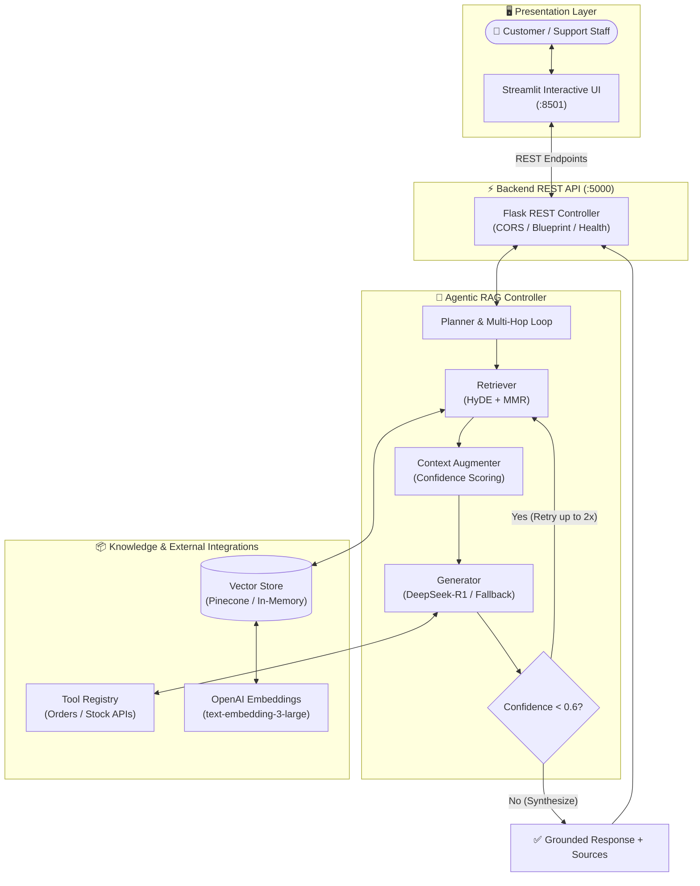

<div align="center">

# 🛒 Agentic E-Commerce Support RAG

### *Autonomous, Self-Correcting AI Customer Support with Multi-Hop Reasoning & Real-Time Tool Calling*

<p align="center">
  <a href="#-key-features">Features</a> •
  <a href="#-architecture">Architecture</a> •
  <a href="#-quickstart">Quickstart</a> •
  <a href="#-how-it-works">How It Works</a> •
  <a href="#-api-reference">API Docs</a> •
  <a href="#-benchmarks">Evaluation</a>
</p>

[](https://www.python.org/)
[](https://www.langchain.com/)
[](https://deepseek.com/)
[](https://platform.openai.com/)
[](https://flask.palletsprojects.com/)
[](https://streamlit.io/)
[](LICENSE)

<br/>

</div>

---

## 💡 Why Agentic RAG?

Traditional customer service chatbots either rely on rigid static rule trees or suffer from hallucinations when answering questions about live orders and dynamic inventory. **Agentic RAG** transforms passive document retrieval into an active, multi-step problem solver.

| Feature | Standard Rule Bots | Traditional RAG | 🚀 Agentic RAG (This Project) |
|---|---|---|---|
| **Transactional Data** (Orders/Stock) | ❌ Rigid / Brittle | ⚠️ Hallucinates fake numbers | ✅ **Deterministic Tool Calling (Zero Hallucination)** |
| **Complex Multi-Hop Queries** | ❌ Fails completely | ❌ Single-pass retrieval | ✅ **Autonomous multi-step reasoning plan** |
| **Low-Relevance Queries** | ❌ Hardcoded fallback | ❌ Garbage in, garbage out | ✅ **Self-correction loop (rephrases & retries)** |
| **Store Policies (Returns/Shipping)** | ❌ Hard to maintain | ⚠️ Mixed accuracy | ✅ **HyDE + MMR semantic vector search** |

---

## ✨ Key Features

### 🛠️ Autonomous Function Calling (Tools)
- **`get_order_status`**: Directly queries live tracking systems for shipment status, carrier details, estimated arrival dates, and dispatch coordinates.
- **`check_product_stock`**: Real-time warehouse inventory checks with restock ETAs for backordered items.

### 🔄 Self-Correction & Query Refinement Loop
- Calculates confidence scores on retrieved document chunks.
- If retrieval confidence falls below **`0.6`**, the agent autonomously refines the prompt using partial context and triggers secondary retrieval passes (up to 2 retries) before answering.

### 🎯 Advanced Retrieval: HyDE + MMR
- **HyDE (Hypothetical Document Embeddings)**: Imagines prototype answers to short/vague user prompts before semantic search, bridging the vocabulary gap between short queries and lengthy policy documents.
- **MMR (Maximal Margin Relevance)**: Enforces diversity across retrieved results, preventing duplicate chunks and maximizing relevant context density.

### ⚡ Resilient Dual Vector Store
- **Pinecone**: Production cloud vector indexing with serverless scaling.
- **In-Memory Cosine Store**: Built-in vector search with deterministic local embeddings for 100% offline, zero-cloud local testing without API keys.

### 🖥️ Modern Interactive Dashboard
- Sleek **Streamlit UI** with full Dark Mode compatibility.
- Live interactive GPS delivery tracking maps.
- Real-time stock gauge progress bars and direct agent routing toggles.

---

## 🏛️ Architecture



---

## 📁 Repository Layout

```
agentic-ecommerce-rag/
├── api/
│   ├── app/
│   │   ├── __init__.py            # Flask app factory, CORS & health endpoints
│   │   ├── routes.py              # REST routes & lazy RAG controller initialization
│   │   └── services/              # Order, product, return & shipping business services
│   ├── integrations/              # FakeStore API integration client
│   └── utils/
│       ├── mock_data.py           # In-memory mock database (orders, catalog, policies)
│       └── redis_manager.py       # Redis session cache with in-memory fallback
├── data/
│   └── documents/                 # Sample policy documents (returns, refunds, warranties)
├── frontend/
│   └── streamlit_app.py           # Modern Streamlit UI with dark-mode theme & live maps
├── rag/
│   ├── agents/
│   │   ├── agentic_controller.py  # Multi-hop orchestration & self-correction loop
│   │   └── tools/tool_registry.py # Tool declarations and function execution schemas
│   ├── augmentation/augmenter.py  # Context prompt assembly & confidence scoring
│   ├── evaluation/                # Golden benchmark dataset (ecommerce.jsonl) & RAGAS scripts
│   ├── generation/generator.py    # DeepSeek API integration with local fallback
│   ├── ingestion/                 # PDF/CSV/JSON loaders & semantic chunker
│   └── retrieval/                 # Vector stores & HyDE/MMR retriever engine
├── tests/                         # Full automated test suite (23 unit & integration tests)
├── .env.example                   # Environment configuration template
├── config.py                      # Application configuration classes
└── requirements.txt               # Pinned Python dependencies
```

---

## ⚡ Quickstart

### Prerequisites
- **Python 3.10+**
- **Git**

### 1. Clone & Set Up Virtual Environment

```bash
# Clone the repository
git clone https://github.com/rahull-1807/agentic-ecommerce-rag.git
cd agentic-ecommerce-rag

# Windows PowerShell
python -m venv venv
.\venv\Scripts\Activate.ps1

# Linux / macOS
python3 -m venv venv
source venv/bin/activate
```

### 2. Install Dependencies

```bash
python -m pip install --upgrade pip
pip install -r requirements.txt
```

### 3. Configure Environment

```bash
# Copy template configuration
cp .env.example .env    # Linux/Mac
Copy-Item .env.example .env   # Windows PowerShell
```

> **Note**: The application defaults to `VECTOR_STORE_TYPE=in_memory` and `USE_MOCK_LLM=true`. It runs **100% locally and offline out-of-the-box** without requiring paid cloud keys. To enable live cloud models, set `OPENAI_API_KEY`, `DEEPSEEK_API_KEY`, and `PINECONE_API_KEY` in `.env`.

### 4. Index Knowledge Base

```bash
python -m rag.retrieval.index_sample_docs
```

### 5. Run Verification Tests

```bash
python -m unittest discover tests
```
*(Runs 23 automated tests verifying health endpoints, order lookups, stock checks, and agentic tools).*

### 6. Start the Services

Open two terminal windows:

**Terminal 1 — Backend REST API:**
```bash
python api/app/__init__.py
```
*Runs at `http://localhost:5000` (Health Check: `http://localhost:5000/api/health`)*

**Terminal 2 — Frontend UI:**
```bash
streamlit run frontend/streamlit_app.py
```
*Opens interactive UI at `http://localhost:8501`*

---

## 💬 Interactive Query Examples

Try these sample queries directly in the Streamlit chat:

```
> "Where is my order ORD-1001?"
⚙️ [Tool Invoked]: get_order_status(order_id="ORD-1001")
🤖 "Your order ORD-1001 is currently Shipped. Expected delivery: 2025-11-08."
   [Confidence: 0.90 | Sources: refund_policy.pdf, shipping_policy.pdf]

> "How many units of Galaxy S21 are available?"
⚙️ [Tool Invoked]: check_product_stock(product_name="Galaxy S21")
🤖 "Galaxy S21 is currently out of stock. Restock expected on 2025-11-20."
   [Confidence: 0.90]

> "What is your return policy for electronics?"
🔍 [Semantic Retrieval]: returns_policy.pdf
🤖 "Customers can return items within 30 days of purchase for a full refund or exchange. Electronics must be in original sealed boxes."
   [Confidence: 0.68 | Source: returns_policy.pdf]
```

---

## 📡 REST API Reference

| Endpoint | Method | Payload / Params | Description |
|---|---|---|---|
| `/health` | `GET` | — | Server health & readiness probe |
| `/api/health` | `GET` | — | Detailed health check with active vector store type |
| `/api/rag/query` | `POST` | `{"query": "string"}` | Full Agentic RAG inference with tool calling & self-correction |
| `/api/orders/<id>` | `GET` | — | Look up order status, ETA, and tracking info |
| `/api/products/<name>/stock` | `GET` | — | Check live inventory stock count & restock date |
| `/api/returns/validate` | `POST` | `{"order_id": "string"}` | Validate return eligibility for an order |
| `/api/returns` | `POST` | `{"order_id": "...", "user_email": "..."}` | Create a return authorization ticket |
| `/api/returns/policy` | `GET` | `?product_id=...` (optional) | Return guidelines |
| `/api/shipping` | `GET` | — | Shipping methods, rates, and carrier info |
| `/api/payment/methods` | `GET` | — | Supported payment gateways and security standards |

---

## 📊 Evaluation Benchmark

The project includes an evaluation suite under `rag/evaluation/`:
- **Golden Benchmark**: `ecommerce.jsonl` contains 20 curated real-world e-commerce test cases pairing customer queries with ground-truth answers, expected tool calls, and document sources.
- **RAGAS Automated Evaluation**: Run `python -m rag.evaluation.evaluate_rag` to assess:
  - **Faithfulness**: Factuality of LLM response against context.
  - **Answer Relevancy**: Precision of the answer to user intent.
  - **Context Recall**: Coverage of retrieved knowledge chunks.
  - **Tool Calling Accuracy**: Exact match on required tool invocations.

---

## 📜 License

Distributed under the **MIT License**. See [`LICENSE`](LICENSE) for more information.

<div align="center">
  <sub>Built with ❤️ using LangChain, DeepSeek-R1, Flask & Streamlit</sub>
</div>
